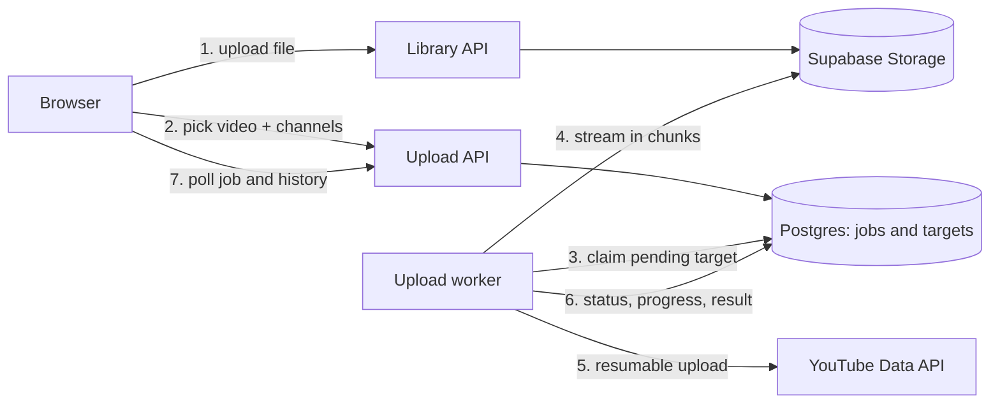

# Youtube Automation Backend

A FastAPI backend for managing many YouTube channels from one place. A user signs up, connects any number of YouTube channels (different Google accounts), keeps videos and images in a private library, and publishes one video to as many channels as they choose in a single action, with live status, automatic retries and a permanent upload history.

## Table of contents

- [Features](#features)
- [Project status](#project-status)
- [How it works](#how-it-works)
- [Tech stack](#tech-stack)
- [Project structure](#project-structure)
- [Getting started](#getting-started)
- [External setup](#external-setup)
- [API reference](#api-reference)
- [Upload engine](#upload-engine)
- [Limits and constraints](#limits-and-constraints)
- [Security](#security)
- [Testing](#testing)
- [Configuration reference](#configuration-reference)
- [Deployment](#deployment)
- [Roadmap](#roadmap)
- [Code conventions](#code-conventions)

## Features

- **Accounts:** sign up, log in, refresh tokens, logout, forgot and reset password. Authentication is built in-house; Supabase Auth is not used.
- **Multiple YouTube channels:** connect, rename, list and disconnect channels. Tokens are encrypted at rest and refreshed automatically. A channel whose permission was revoked is flagged "needs reconnect".
- **Library (Storage):** upload videos and images once, tag them, search and filter them, and reuse them. Files live in a private Supabase Storage bucket.
- **Multi-channel publishing:** pick a video from the library, pick any number of connected channels (up to 50 per upload by default), and publish with the same title, description, tags and settings everywhere.
- **Reliable delivery:** every channel is processed independently with its own status and progress. A failure on one channel never stops the others. Temporary errors are retried automatically.
- **Upload history:** a permanent record of what was published, with which title, description and tags, to which channels, and whether each one succeeded or failed.
- **Quota awareness:** a daily upload counter keeps the app inside the YouTube API limit and refuses jobs that cannot fit.

## Project status

| Area | Status |
|---|---|
| Auth: signup, login, refresh, logout, forgot and reset password | Done and tested |
| YouTube accounts: connect, rename, list, disconnect, token refresh | Done |
| Library: upload, list, tag, delete videos and images | Done |
| Multi-channel upload jobs: retries, status tracking, history, quota | Implemented. Run an end-to-end check against your own Google project before production |
| Deployment on GCP | Not started |

## How it works



1. A video that is on the user's computer is first uploaded to the library (`POST /storage/files`). A video already in the library is used directly.
2. The user creates an upload job: one library video, one set of metadata, and a list of channels. The API validates everything, saves the job and returns immediately.
3. A background worker claims waiting channel targets one by one (several in parallel), streams the video from Storage to YouTube in 8 MB chunks, and writes progress and the final result back to the database.
4. The client polls the job to show live status, and reads the history later.

## Tech stack

- Python 3.12, FastAPI, Uvicorn
- SQLAlchemy 2 (async) with asyncpg, Supabase Postgres
- Supabase Storage (private bucket) accessed through its REST API
- Google OAuth 2.0 and YouTube Data API v3 (`google-api-python-client`)
- Argon2 password hashing, JWT access tokens, rotating refresh tokens
- Fernet encryption for Google tokens
- SMTP (Gmail) for password reset codes
- Pydantic Settings for configuration
- Pytest, pytest-asyncio, httpx for tests

## Project structure

```
main.py                  application entrypoint (uvicorn main:app)
app/
  config.py              all settings: values from .env plus fixed values
  core/                  database, security, exceptions, handlers, logging, dependencies
  models/                SQLAlchemy tables
  schemas/               request and response models
  crud/                  database queries
  service/               business logic
  routes/                API endpoints
  integrations/          external systems (SMTP, YouTube API)
  workers/               background jobs (YouTube upload worker)
  utils/                 helpers: validators, retry and error rules, bucket client, tokens
tests/                   automated tests
```

Each feature has one file per layer:

| Feature | File name in every layer |
|---|---|
| Authentication | `auth.py` |
| YouTube account connection | `yt_management.py` |
| Library | `storage_bucket.py` |
| Multi-channel upload | `yt_channel_management.py` |

## Getting started

### Prerequisites

- Python 3.12
- A Supabase project (database and storage)
- A Google Cloud project with YouTube Data API v3 enabled
- On Windows, the `tzdata` package (the daily quota follows Pacific Time)

### Run locally

1. Create and activate a virtual environment.
2. Install dependencies: `pip install -r requirements.txt` (use `requirements-dev.txt` to also run tests). Make sure `tzdata` is included.
3. Create `.env` from `.env.example` and fill in the values below.
4. Start the server: `uvicorn main:app --reload`
5. Open `http://localhost:8000/docs`.

Tables are created automatically on startup. The upload worker starts with the app.

To run the worker as a separate process instead, set `yt_upload_worker_enabled` to `False` in `app/config.py` for the API process and run `python -m app.workers.yt_channel_management` in another terminal.

### Environment variables

Only these live in `.env`. Everything else is fixed in `app/config.py`.

| Variable | Required | Purpose |
|---|---|---|
| `DATABASE_URL` | Yes | Supabase Postgres connection string. Use the Session pooler string from Connect in the Supabase dashboard. |
| `JWT_SECRET_KEY` | Yes | Random secret, at least 32 characters. Also used to hash reset codes. |
| `SMTP_USERNAME` | For reset emails | Gmail address that sends the codes. Also used as the From address. |
| `SMTP_PASSWORD` | For reset emails | Gmail app password. |
| `SUPABASE_URL` | Library and uploads | Project URL from the Supabase dashboard. |
| `SUPABASE_SERVICE_ROLE_KEY` | Library and uploads | Secret key (`sb_secret_...`) from Settings, API Keys. Backend only. |
| `GOOGLE_CLIENT_ID` | YouTube | OAuth client ID from Google Cloud. |
| `GOOGLE_CLIENT_SECRET` | YouTube | OAuth client secret from Google Cloud. |
| `TOKEN_ENCRYPTION_KEY` | YouTube | Fernet key used to encrypt Google tokens before saving them. |

Generate a JWT secret: `python -c "import secrets; print(secrets.token_urlsafe(64))"`

Generate a token encryption key: `python -c "from cryptography.fernet import Fernet; print(Fernet.generate_key().decode())"`

## External setup

### Supabase

1. Create a project at supabase.com and keep the database password safe.
2. Click Connect in the project, choose Session pooler and copy the string into `DATABASE_URL`. Replace the password placeholder and URL-encode special characters in the password.
3. Start the app and check `GET /health/ready`. It should report the database as up.
4. Enable row level security on every table so the public Supabase REST API cannot read them. The backend connects as the database owner and is not affected:

```sql
ALTER TABLE public.users ENABLE ROW LEVEL SECURITY;
ALTER TABLE public.refresh_tokens ENABLE ROW LEVEL SECURITY;
ALTER TABLE public.password_reset_otps ENABLE ROW LEVEL SECURITY;
ALTER TABLE public.youtube_accounts ENABLE ROW LEVEL SECURITY;
ALTER TABLE public.oauth_states ENABLE ROW LEVEL SECURITY;
ALTER TABLE public.storage_files ENABLE ROW LEVEL SECURITY;
ALTER TABLE public.storage_file_tags ENABLE ROW LEVEL SECURITY;
ALTER TABLE public.yt_upload_jobs ENABLE ROW LEVEL SECURITY;
ALTER TABLE public.yt_upload_targets ENABLE ROW LEVEL SECURITY;
ALTER TABLE public.yt_upload_quota_days ENABLE ROW LEVEL SECURITY;
```

Repeat this for every new table. The private storage bucket (`artifacts`) is created automatically on the first upload.

### Google Cloud

1. Create a project in Google Cloud Console and enable **YouTube Data API v3**.
2. Configure the OAuth consent screen. While it is in Testing mode, add every Gmail you will connect as a test user and note that refresh tokens expire after 7 days. Publish and verify the app for real users.
3. Create an OAuth client of type **Web application** with the redirect URI `http://localhost:8000/api/v1/youtube/callback` (use your deployed callback URL in production).
4. Put the client ID and secret in `.env`.

The app requests these scopes: `openid`, `userinfo.email`, `youtube.upload` and `youtube.readonly`. They cover uploading videos, setting thumbnails and reading channel details. Adding a scope later means every channel has to be connected again.

## API reference

Base prefix: `/api/v1`. Interactive documentation is at `/docs` outside production. Protected endpoints need `Authorization: Bearer <access_token>`.

### Auth

| Method and path | Auth | Description |
|---|---|---|
| `POST /auth/signup` | No | Create an account and log in immediately. |
| `POST /auth/login` | No | Log in. |
| `POST /auth/refresh` | No | Exchange a refresh token for a new token pair. |
| `POST /auth/logout` | No | Revoke a refresh token. |
| `POST /auth/forgot-password` | No | Email a one-time code. The response is the same whether or not the email exists. |
| `POST /auth/reset-password` | No | Verify the code and set a new password. |
| `GET /auth/me` | Yes | Return the logged in user. |

Signup and login return `{ "user": {...}, "tokens": { "access_token", "refresh_token", "token_type", "expires_in" } }`.

### YouTube accounts

| Method and path | Description |
|---|---|
| `POST /youtube/connect` | Body: `{ "nickname": "..." }`. Returns the Google consent URL; redirect the user to it. |
| `GET /youtube/callback` | Used by Google only. Redirects to `{frontend_url}/youtube/connect?status=success` or `status=error`. |
| `GET /youtube/accounts` | List connected channels. A channel that needs to be connected again has `needs_reconnect: true`. |
| `PATCH /youtube/accounts/{id}` | Rename a channel. |
| `DELETE /youtube/accounts/{id}` | Revoke the Google token and disconnect the channel. |

A channel can be connected once per user. Connecting it again refreshes its tokens.

### Library (Storage)

| Method and path | Description |
|---|---|
| `POST /storage/files` | Upload one video or image as multipart form data. Optional `tags` field, comma separated. |
| `GET /storage/files` | List files with temporary signed URLs. Filters: `type`, `tags`, `search`, `limit`, `offset`. |
| `PATCH /storage/files/{id}` | Replace the tags of a file. |
| `DELETE /storage/files/{id}` | Delete a file. |

Videos: MP4, MOV, AVI, MKV, WEBM, MPEG. Images: JPG, PNG, WEBP, GIF.

### Multi-channel upload

| Method and path | Description |
|---|---|
| `POST /yt-channels/uploads` | Start an upload of one library video to many channels. Returns the job with one target per channel. |
| `GET /yt-channels/uploads` | Upload history, newest first. Filters: `status`, `account_id`, `search` (title), `date_from`, `date_to`, `limit`, `offset`. |
| `GET /yt-channels/uploads/{id}` | One job with the status, progress, YouTube link and error of every channel. Poll this for live progress. |
| `GET /yt-channels/uploads/quota` | Uploads left today: daily limit, used, waiting, remaining and the reset time. |
| `POST /yt-channels/uploads/{id}/retry` | Run the failed channels again. |
| `POST /yt-channels/uploads/{id}/cancel` | Cancel every channel that has not finished. |

Create request:

```json
{
  "storage_file_id": "5b1f0c0e-...",
  "account_ids": ["a1...", "b2..."],
  "title": "My video",
  "description": "About the video",
  "tags": ["travel", "vlog"],
  "category_id": "22",
  "privacy_status": "private",
  "publish_at": null,
  "made_for_kids": false,
  "default_language": "en",
  "notify_subscribers": true,
  "thumbnail_file_id": null
}
```

| Field | Rules |
|---|---|
| `storage_file_id` | Required. A video from the user's library. |
| `account_ids` | Required. 1 to 50 connected channels that are active and not waiting for a reconnect. Duplicates are ignored. |
| `title` | Required. 1 to 100 characters, no `<` or `>`. |
| `description` | Up to 5000 bytes, no `<` or `>`. |
| `tags` | Up to 500 characters in total, each tag up to 30 characters. Duplicates are ignored. |
| `category_id` | YouTube category ID. Default `22`. |
| `privacy_status` | `public`, `unlisted` or `private`. Default `private`. |
| `publish_at` | Optional schedule time with a timezone, in the future. Forces `private` until that time. |
| `made_for_kids` | Default `false`. |
| `notify_subscribers` | Default `true`. |
| `thumbnail_file_id` | Optional JPG or PNG from the library. |

Example job response (shortened):

```json
{
  "id": "9c7e...",
  "status": "running",
  "title": "My video",
  "total_channels": 2,
  "done_count": 1,
  "failed_count": 0,
  "active_count": 1,
  "targets": [
    {
      "account_nickname": "Gaming",
      "channel_title": "My Gaming Channel",
      "status": "done",
      "progress_percent": 100,
      "attempts": 1,
      "youtube_url": "https://www.youtube.com/watch?v=...",
      "thumbnail_status": "done"
    },
    {
      "account_nickname": "Vlogs",
      "channel_title": "My Vlogs",
      "status": "uploading",
      "progress_percent": 42,
      "attempts": 1
    }
  ]
}
```

### Health

| Method and path | Description |
|---|---|
| `GET /health` | Liveness check. |
| `GET /health/ready` | Readiness check including the database. |

### Error format

Every error uses one shape:

```json
{
  "success": false,
  "error": {
    "code": "validation_error",
    "message": "Some of the information you entered is not valid. Please review it and try again.",
    "details": [{ "field": "title", "message": "The title cannot be empty." }]
  }
}
```

`details` appears only for validation errors. Use `error.code` for logic and `error.message` for display.

## Upload engine

### Statuses

| Level | Values |
|---|---|
| Job | `queued`, `running`, `completed`, `partially_completed`, `failed`, `cancelled` |
| Channel (target) | `pending`, `uploading`, `retrying`, `done`, `failed`, `cancelled` |
| Thumbnail | `none`, `pending`, `done`, `failed` |

The job status is derived from its targets: all `done` is `completed`, some `done` and some not is `partially_completed`, none `done` with at least one `failed` is `failed`.

### Retries and errors

A channel is retried automatically, up to 3 attempts with growing delays (30 seconds, then 2 minutes), only when the error is temporary. Errors that cannot be fixed by waiting fail immediately with a clear message, and never block other channels. `POST .../retry` runs the failed channels again with fresh attempts.

| `error_code` | Meaning | Retried automatically |
|---|---|---|
| `network_error` | Connection interrupted | Yes |
| `youtube_unavailable` | YouTube had a temporary problem or rate limit | Yes |
| `storage_unavailable` | Storage could not be reached | Yes |
| `source_unreadable` | The video could not be read from storage | Only for temporary read errors |
| `quota_exceeded` | The daily project limit was reached. All waiting channels fail with this code | No |
| `channel_upload_limit` | The channel reached its own daily upload limit | No |
| `reconnect_required` | The channel permission was revoked or expired. The channel is flagged for reconnect | No |
| `account_unavailable` | The channel was disconnected or removed | No |
| `invalid_video_details` | YouTube rejected the title, description, tags or schedule | No |
| `no_youtube_channel` | The Google account has no YouTube channel | No |
| `forbidden`, `rejected_by_youtube` | YouTube refused the request | No |
| `source_missing` | The video was deleted from the library before it was uploaded | No |
| `interrupted` | The server stopped repeatedly during the upload | No |
| `unexpected_error` | Anything else. Details are in the server log | No |

### Quota

The default YouTube quota is shared by the whole Google Cloud project, not per channel or per user. The app keeps a daily counter (Pacific Time, matching Google's reset) and counts every attempt that reaches YouTube, including retries. A new upload is refused with a clear message when the selected channels need more uploads than are left. The limit is `yt_upload_daily_limit` (default 100); raise it after Google approves a quota extension.

### History

History is permanent. Each job keeps its own copy of the video file name, title, description, tags and settings, and each channel entry keeps the channel name and nickname as they were at upload time. The record stays correct even if the library file is deleted or the channel is renamed or disconnected later.

### Worker behavior

- The video is streamed from Supabase Storage to YouTube in 8 MB chunks with HTTP range requests. Nothing is written to disk.
- Up to 3 channels upload in parallel (`yt_upload_concurrency`).
- Waiting work is claimed with `FOR UPDATE SKIP LOCKED`, so more than one worker can run safely.
- Uploads that were running when the server stopped return to the queue after 10 minutes.
- On shutdown the worker asks running uploads to stop at the next chunk and puts them back in the queue.
- A thumbnail is set after the video is uploaded. If it fails the video stays `done` and the channel shows `thumbnail_status: failed` with the reason.

## Limits and constraints

- **Daily upload limit:** the default is 100 uploads per day for the whole project (see Quota). One video sent to 20 channels uses 20.
- **Channel limits:** YouTube also applies its own daily upload limit per channel, especially to new or unverified channels. Such a failure is reported as `channel_upload_limit`.
- **Library file size:** the app allows videos up to 50 MB (`storage_video_max_bytes`) and images up to 10 MB. Your Supabase plan has its own per-file limit. Real videos are usually larger, so raise both limits together or move video storage to Google Cloud Storage.
- **Custom thumbnails:** YouTube may require the channel to be verified. The video is still published if the thumbnail is refused.
- **Consent screen:** in Testing mode refresh tokens expire after 7 days and only listed test users can connect. Publish and verify the app before real users connect.
- **Compliance audit:** Google may require an API compliance audit before large scale use or a higher quota.
- **Deleting a library video** while it is part of a running upload makes the remaining channels fail with `source_missing`.

## Security

- Passwords are hashed with Argon2 and checked in a worker thread so the event loop is never blocked.
- Password rules: at least 8 characters with at least one letter and one number.
- Access tokens are short lived JWTs. Refresh tokens are random, stored only as hashes and rotated on every use. Reusing an old refresh token revokes all sessions of that user.
- Reset codes are 6 digits, valid for 10 minutes, single use, stored as keyed hashes, locked after 5 wrong attempts, with a 60 second resend cooldown.
- Login errors and forgot-password responses do not reveal whether an email is registered.
- A successful password reset revokes every active session.
- Google access and refresh tokens are encrypted with Fernet before they are stored and are never returned by the API.
- OAuth uses a single-use `state` value stored in the database and valid for 10 minutes to prevent forged callbacks.
- Every upload, library and channel query is scoped to the logged in user.
- Secrets are read as `SecretStr` and never logged.

## Testing

```
pip install -r requirements-dev.txt
pytest
```

The tests use an in-memory SQLite database and a recording email service, so they never send real email or touch Supabase or YouTube. `tests/test_yt_channel_management_utils.py` covers validation, job status, retry delays, quota day, and YouTube error classification.

## Configuration reference

Fixed values live in `app/config.py`. The ones most often changed:

| Setting | Default | Purpose |
|---|---|---|
| `log_sql` | `False` | Print every SQL statement in the log. Turn on only when debugging. |
| `yt_upload_max_accounts` | 50 | Channels allowed in one upload |
| `yt_upload_max_attempts` | 3 | Attempts per channel |
| `yt_upload_retry_delays_seconds` | `[30, 120]` | Wait before the 2nd and 3rd attempt |
| `yt_upload_concurrency` | 3 | Channels uploaded in parallel |
| `yt_upload_daily_limit` | 100 | Uploads per day for the whole project |
| `yt_upload_chunk_bytes` | 8 MB | Size of each chunk sent to YouTube |
| `yt_upload_worker_enabled` | `True` | Start the worker inside the API process |
| `yt_upload_worker_poll_seconds` | 3 | How often an idle worker looks for work |
| `yt_upload_stale_after_seconds` | 600 | When an interrupted upload returns to the queue |
| `yt_default_privacy` | `private` | Privacy used when the request does not set one |
| `storage_video_max_bytes` | 50 MB | Largest video accepted by the library |
| `google_scopes` | upload, readonly | OAuth scopes requested from Google |

## Deployment

- Target: Cloud Run. Start command: `uvicorn main:app --host 0.0.0.0 --port $PORT` (no `--reload`).
- Set `APP_ENV=production`, `CORS_ORIGINS` and `GOOGLE_REDIRECT_URI` as environment variables. Keep `DATABASE_URL`, `JWT_SECRET_KEY`, `SMTP_PASSWORD`, `TOKEN_ENCRYPTION_KEY` and the Google and Supabase secrets in Secret Manager.
- The upload worker needs CPU while no request is running. Run it as its own service with CPU always allocated (`python -m app.workers.yt_channel_management`) and set `yt_upload_worker_enabled` to `False` for the API service, or use a Cloud Run service with minimum one instance and always-on CPU.
- A Dockerfile is still to be written.
- Tables are created with `create_all`, which only creates missing tables. It does not change existing ones. When a column must be added later, run the SQL manually in the Supabase SQL editor, or introduce Alembic before the schema changes often.

## Roadmap

- Resumable browser uploads straight to storage for large videos.
- Per-channel title and description overrides in one upload.
- Scheduled publishing across channels with different times.
- Rate limiting on login, signup and forgot-password.
- Dockerfile, CI pipeline and Cloud Run deployment.
- Structured logging and error monitoring.
- Alembic migrations once tables change often.
- Rotate every credential that was shared during development: database password, JWT secret, Gmail app password.

## Code conventions

- One file per feature in every layer. A new, unrelated feature gets its own file name in each layer.
- Routes stay thin. Business rules live in `service`, queries live in `crud`.
- Nothing is hardcoded outside `app/config.py`. Secrets and environment specific values come from `.env`; fixed values are constants inside `config.py`.
- No comments in code except the file path on the first line, no emojis, user friendly error messages in English.